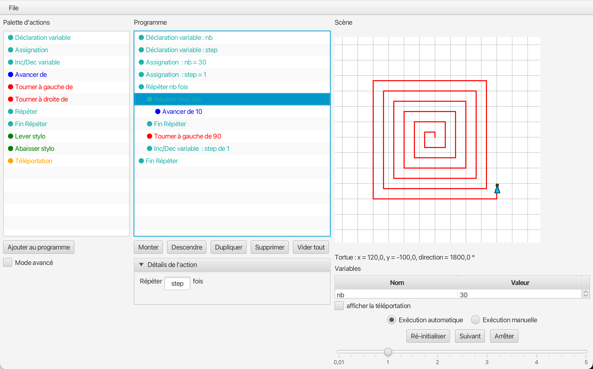
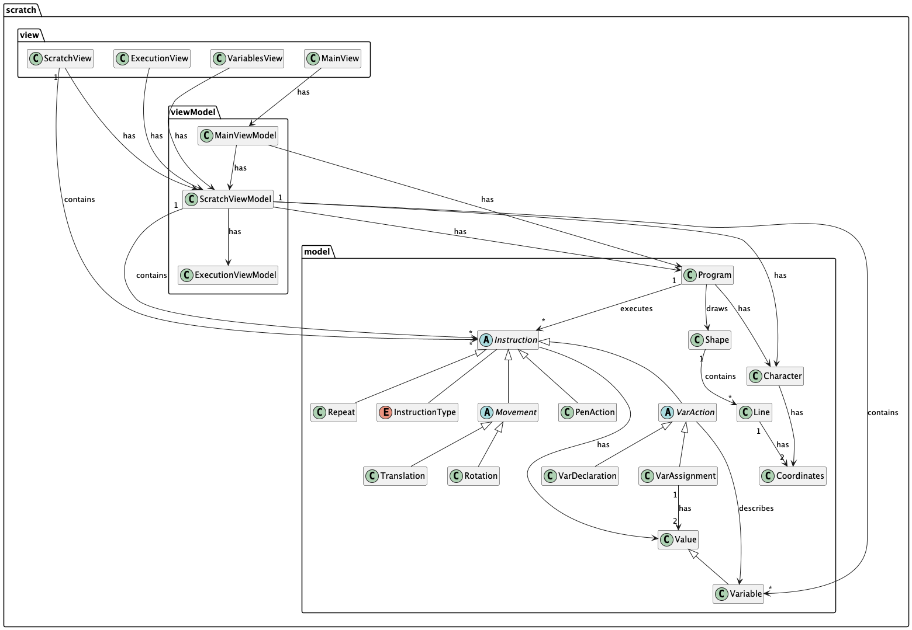
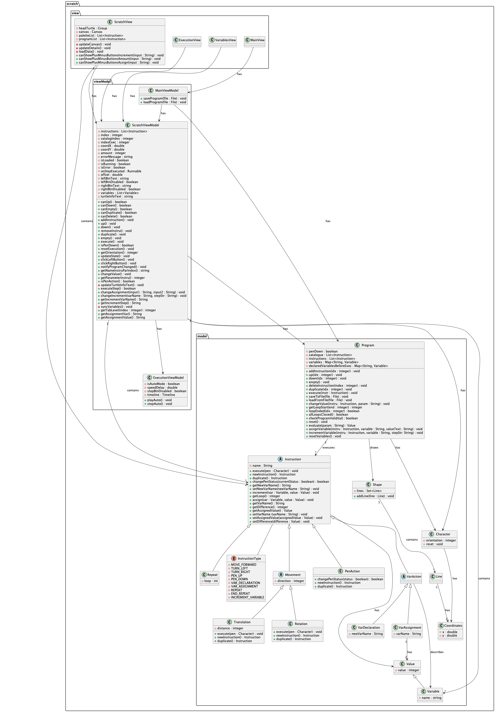
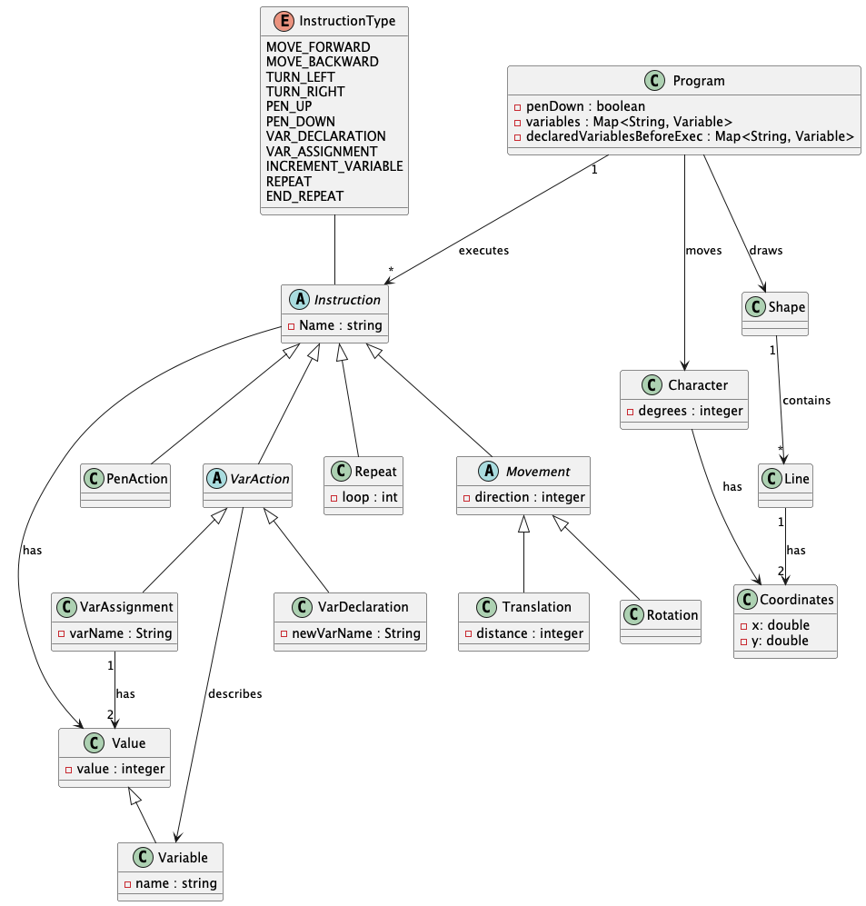

# Scratch-like drawing program

A desktop app inspired by Scratch, made with [Bilal El Azzouzi](https://github.com/eab98) and [Anass Adahchour](https://github.com/adhanass) for a school project at EPFC (2025-2026).

You build a small drawing program from a catalogue of actions (move, turn, pen up/down, variables, loops), set the parameters of each action, then run it step by step or automatically and watch the cursor draw on the canvas. Programs can be saved to a file and loaded again.

Made with Java and JavaFX, following the MVVM pattern (model, view models, views). Each instruction knows how to execute itself (Command pattern).

## Screenshots

## Analysis and design

This project was part of an analysis and design course, so the modelling came before the code.

- Before coding, we made a domain class diagram of the problem (the actions, their parameters, how a program is executed) and had it validated by our professor.
- In the second iteration, we updated the domain diagram with the new features (variables, loops) before implementing them.
- At the end, we made a software class diagram showing the real structure of the app: the model, the view models and the views, and how they are linked.

The diagrams are below, and the PlantUML sources are in the `UML` folder.

## Class diagrams

Software class diagram (detailed)

Domain class diagram (analysis)

## What I did

In the model:
- the movement actions, including calculating the new position from the direction and the distance
- variables: declaration, and part of the assignment
- matching each REPEAT with its END_REPEAT, also for nested loops
- the button actions

Errors:
- input validation in the detail panel: each parameter is checked while you type (for example, an angle must be between 1° and 180°, otherwise an error is shown in the panel)
- execution errors: errors found while the program runs (for example a negative number of repetitions), which stop the execution

In the views and view models:
- the action detail panel, in both iterations, from the view to the model
- the action catalogue, the program and the initial grid
- the indentation of loops, button bindings, coordinates and execution

## Run it

You need Java 25 and Maven.

Open the project in IntelliJ and run the class `scratch.App`.